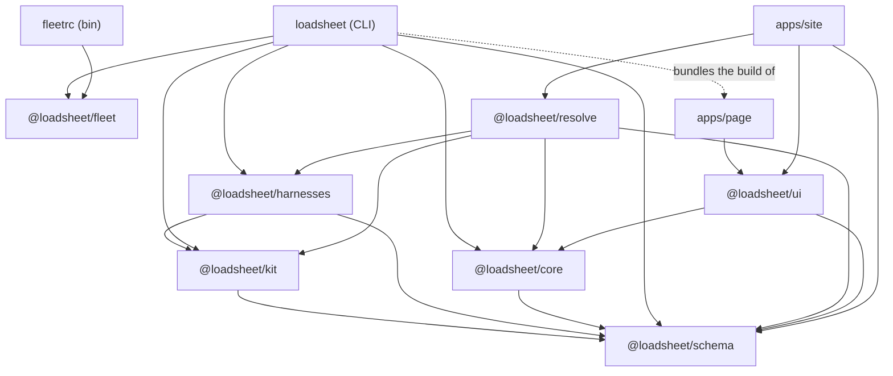

# loadsheet spec

How the packages fit together: what each one owns, the data that moves between them, and which files change when you add a harness or a rule. `AGENTS.md` has the rules (privacy, where each package may run, releases). `DESIGN.md` has the web UI.

## The pipeline

A machine scan combines windowed transcript tallies with an independent inventory of installed items. A harness that only inventories installed files can contribute to a Scan without any transcript facts. `buildReport` takes machine Scans and a resolved config.

```text
transcript line ──parse──▶ Fact ──fold──▶ Tally ──window──▶ Scan ──buildReport──▶ Report ──▶ text, JSON, web page
   (harnesses)            (kit)          (kit, cached)     (kit/node)    (core)           (core, loadsheet, ui)
                                                             ▲
installed files ──inventory──▶ Items ────────────────────────┘
```

| Type     | Defined in            | What it is                                                                                                                                                  |
| -------- | --------------------- | ----------------------------------------------------------------------------------------------------------------------------------------------------------- |
| `Fact`   | `kit/src/index.ts`    | What one transcript line says: a session started, its first tokens, its context window, an item listed or used. Names, days and counters only.              |
| `Tally`  | `kit/src/fold.ts`     | Facts summed, keyed by day. Folding is a sum, so the cache can store one Tally per transcript file and add them later.                                      |
| `Scan`   | `schema/src/types.ts` | One machine: per harness, its coverage, installed `Item`s and the `Cell` counters for the window. This is what a fleet machine sends over ssh.              |
| `Report` | `schema/src/types.ts` | One `Sheet` per harness (a `Line` per item, summed over machines), the `Finding`s the rules made, each with its `Fix`es, and the rules that were `Skipped`. |
| `Config` | `schema/src/types.ts` | The user's config file. `resolveConfig` fills in the defaults and returns a `ResolvedConfig`.                                                               |

`Scan`, `Report` and `Config` are the public contract, at schema version 1. `@loadsheet/schema` holds both the valibot schemas and the TypeScript types. The JSON Schemas in `schema/schema/*.json` are generated from them and served at `loadsheet.dev/schema/`. The prompt in `docs/agent-prompt.md` is written against the Report's fields, so a field change has to update it too.

A pack (a skills folder or repository, read without any sessions) skips transcript processing and the Scan. `Files` go into `harness.inventory`, and `packReport` turns the resulting `Item`s into a Report. Only the rules that need no usage data run on it.

## Packages



`core` never imports `kit` or `harnesses`, so the rules depend only on schema types. `fleet` imports nothing from loadsheet.

### `@loadsheet/schema` (`packages/schema`)

- Owns the public types and their validation. `parseScan`, `parseReport` and `parseConfig` throw a `SchemaError` that lists each issue with its JSON path.
- `RULES` and `SIGNALS` list every rule id and every signal. The default rule thresholds live in `DEFAULT_RULES` in `src/index.ts`.
- `shareableReport` drops descriptions before a Report goes into a share link.

### `@loadsheet/kit` (`packages/kit`)

Two entries:

- `.` is the contract a harness adapter is written against: `Files`, `Fact`, `TranscriptFormat`, `MachineReader`, `Harness` and `defineHarness`. It also holds `fold.ts`, which turns Facts into a Tally, Tallies into a Scan, and merges Scans and Items.
- `./node` touches the disk:
  - `scanMachine` (`scan.ts`) runs a full machine scan: it finds transcript files changed in the window and reads them through the cache.
  - `cache.ts` stores a cursor and a Tally per transcript file, keyed by a salted hash. It is the only thing loadsheet writes.
  - `reader.ts` streams JSONL lines (ported from t3code). `workers.ts` runs the reads on worker threads once there are enough files to be worth it.
  - `files.ts` (`dirFiles`) and `github.ts` (`githubFiles`, from a tarball) produce `Files` for packs.
  - `reach.ts` works out what removing an Item would also remove, by walking inodes. Fixes use this to avoid deleting a folder that another Item needs.

### `@loadsheet/harnesses` (`packages/harnesses`)

One adapter per coding agent, listed in `harnesses` in `src/index.ts`. An adapter is a `Harness`: its `signals` grades, `inventory(files)` for packs, and an optional `machine` reader.

- `claude-code` and `codex` read transcripts. Each has a `*-transcripts.ts` file with its `TranscriptFormat`, and a listing file that knows how the harness turns an entry into characters in the context.
- `grok`, `pi`, `opencode`, `cursor`, `gemini` and `kiro` only read what is installed (`NO_USAGE` grades, helpers in `inventory.ts`). Their sheets have no sessions.
- `managed.ts` reads fleetrc's manifest and the skills CLI's lock to tell who installed a skill folder. It only reads files and never runs either tool.
- `pack.ts` (`packInventory`) finds every `SKILL.md`, plus a plugin's commands and agents, in a pack.

Adapters work on the `Files` and `Place` kit gives them, and never read the disk themselves.

### `@loadsheet/core` (`packages/core`)

- `buildReport` (`report.ts`) takes one Scan per machine and the resolved config. It filters by harness and entrypoint, sums lines over machines, and runs the rules. The `ignore` list filters the lines the rules see, not the lines or costs in the Report.
- `packReport` (`pack.ts`) does the same for a pack, with `NO_SIGNALS`.
- `engine.ts` (`runRules`) runs each enabled rule on the sheets that can answer it. A sheet without a required signal is skipped as `missing-signal`, and one with too little history as `not-enough-data`. It also drops a fix that a cut finding already covers.
- `rules/` has one file per rule. A rule declares the signals it needs and returns findings.
- `fixes.ts` writes the commands and settings edits for each harness and installer. loadsheet itself never runs them.
- `summary.ts` writes the default terminal output (the context bar per harness, and the item-by-item breakdown for `loadsheet <harness>`). `text.ts` writes `--full`. `setup.ts` holds the token figures that both the text and the web page show.

### `loadsheet` (`packages/loadsheet`)

The npm bin. `cli.ts` routes to one of three places:

- `fleet …` goes to `@loadsheet/fleet`'s `run`.
- `build` and `--ui` go to `ui.ts`. It inlines the Report into the `apps/page` build (copied into `dist/web` by `scripts/copy-web.ts`) and writes it to a folder or serves it on 127.0.0.1.
- Everything else goes to `main.ts`, which parses flags and config. It then either scans and builds a Report, prints `--scan`, or weighs a pack.

`scan-worker.ts` is the worker module `scanMachine` starts. `fleet.ts` (`fleetScans`) checks the Scans other machines send back and strips any key the schema doesn't name. A host that fails becomes one of the fixed `Unread` phrases.

`main.ts` (`askFleet`) builds the remote scan command: `npx -y loadsheet@<version>` by default, or the nonempty `LOADSHEET_FLEET_COMMAND` override, followed by `--scan --days <window>` and `--no-cache` if requested. It passes that argument list to `runOnFleet`.

### `@loadsheet/fleet` and `fleetrc`

fleetrc's whole CLI: manifests, sources, sync, agent hooks, timers and running commands over ssh. loadsheet uses two exports. `runOnFleet` runs the caller's argument list over SSH on every other fleet host, and `run` backs `loadsheet fleet`. `packages/fleetrc` is the private package that ships the `fleetrc` bin and `schema.json`.

### `@loadsheet/resolve` (`packages/resolve`)

Weighs a GitHub skills source for loadsheet.dev. `parsePackSource` supports GitHub source forms from `skills add`, not local paths or other hosts. `resolvePack` downloads the GitHub tarball through `githubFiles`, builds `memoryFiles`, then runs `skills.resolveSource` on a temporary local copy to discover which skills to weigh. It inventories those skills with the Claude Code adapter and calls `packReport`. `test/parity.test.ts` checks discovery against the skills CLI.

### `@loadsheet/ui` (`packages/ui`)

The Vue views (`Landing`, `ReportShell`, `Report`, `Fixes`, `Pack`) and their components. `createLoadsheet()` (`lib/state.ts`) holds the Report on screen and provides it to the views. `lib/share.ts` packs a Report into the URL fragment. Views link by route name (`home`, `report`, `fixes`, `pack`), so each host registers routes under those names.

### Apps

- `apps/page` is the single static HTML file. `src/main.ts` reads the inlined Report or a share code from the hash, then mounts the views on a hash router (`src/routes.ts`).
- `apps/site` is loadsheet.dev on Nuxt and ViteHub. `app/pages` mounts the same views on path routes. `server/api/resolve.get.ts` is `GET /api/resolve?source=…`, rate-limited, calling `resolvePack`. `content/docs` holds the docs that the ViteHub CMS edits, and its D1 database only stores CMS editor sessions. `app/plugins/legacy-hash.client.ts` redirects the old `/#/…` links.

### Test and build support

- `@loadsheet/fixtures` sanitizes real transcripts into fixtures, and plants canary text that a test fails on if it reaches a Scan, a Report or the cache.
- `scripts/check-tarballs.ts` checks what each published package ships.
- `examples/*.json` are one valid document of each type. Tests parse them, and the UI draws `report.example.json` on the landing page.

## Adding a harness

1. Write `packages/harnesses/src/<id>.ts` with `defineHarness`. Use the helpers in `inventory.ts` if it only reads what is installed. If it reads transcripts, add a `TranscriptFormat`, and a fixture made with `pnpm --filter @loadsheet/fixtures sanitize`.
2. Add it to `harnesses` and the exports in `src/index.ts`. Update the ordered list of built-in IDs in `packages/harnesses/test/inventory-only.test.ts`.
3. Give it a display name in `core/src/summary.ts` (`NAMES`, plus its folders for grouping fixes) and in `ui/src/lib/report.ts` (`HARNESS`); without one, its id shows. If it can hide a skill from its model, add that fix in `core/src/fixes.ts`.
4. List it in `apps/site/content/docs/guide/index.md` and `reference/index.md`.

## Adding a rule

1. Add its id to `RULES`, its options to the standalone `ConfigSchema`, its types in `types.ts`, and its defaults in `DEFAULT_RULES`. In `schema/src/schemas.ts`, make the new rule entry optional in `ResolvedConfigSchema`, which validates the resolved config embedded in a Report. New reports can include the defaults, but `parseReport` must still accept older v1 reports and share links without the new `config.rules` entry. Run `pnpm --filter @loadsheet/schema generate`.
2. Write `core/src/rules/<id>.ts` with `defineRule` and add it to `rules/index.ts`.
3. Give it its words in `core/src/text.ts`, `core/src/summary.ts` and `ui/src/lib/report.ts`.
4. Document it in `apps/site/content/docs/reference/rules.md` and in `examples/loadsheet.config.example.json`.
