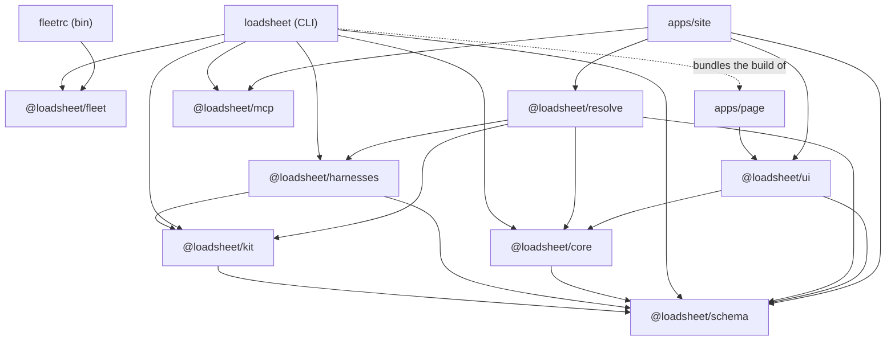

# loadsheet spec

How the packages fit together: what each one owns, the data that moves between them, and which files change when you add a harness or a rule. `AGENTS.md` has the rules (privacy, where each package may run, releases). `DESIGN.md` has the web UI.

## The pipeline

A machine scan combines windowed transcript tallies with an independent inventory of installed items. A harness that only inventories installed files can contribute to a Scan without any transcript facts. `buildReport` takes machine Scans and a resolved config.

```text
transcript line ──parse──▶ Fact ──fold──▶ Tally ──window──▶ Scan ──buildReport──▶ Report ──▶ text, JSON, web page
   (harnesses)            (kit)          (kit, cached)     (kit/node)    (core)           (core, loadsheet, ui)
                                                             ▲
installed files ──inventory──▶ Items ────────────────────────┘
```

| Type     | Defined in            | What it is                                                                                                                                                                                                               |
| -------- | --------------------- | ------------------------------------------------------------------------------------------------------------------------------------------------------------------------------------------------------------------------ |
| `Fact`   | `kit/src/index.ts`    | What one transcript line says: a session started, its first tokens, its context window, an item listed or used, and for usage a conversation started, a compaction or a request's tokens. Names, days and counters only. |
| `Tally`  | `kit/src/fold.ts`     | Facts summed, keyed by day. Folding is a sum, so the cache can store one Tally per transcript file and add them later.                                                                                                   |
| `Scan`   | `schema/src/types.ts` | One machine: per harness, its coverage, installed `Item`s and the `Cell` counters for the window, and the machine's `usage`. This is what a fleet machine sends over ssh.                                                |
| `Report` | `schema/src/types.ts` | One `Sheet` per harness (a `Line` per item, summed over machines), the `Finding`s the rules made, each with its `Fix`es, the rules that were `Skipped`, and `usage` summed over machines.                                |
| `Config` | `schema/src/types.ts` | The user's config file. `resolveConfig` fills in the defaults and returns a `ResolvedConfig`.                                                                                                                            |

`Scan`, `Report` and `Config` are the public contract, at schema version 1. `@loadsheet/schema` holds both the valibot schemas and the TypeScript types. The JSON Schemas in `schema/schema/*.json` are generated from them and served at `loadsheet.dev/schema/`. The prompt in `docs/agent-prompt.md` is written against the Report's fields, so a field change has to update it too.

A pack (a skills folder or repository, read without any sessions) skips transcript processing and the Scan. `Files` go into `harness.inventory`, and `packReport` turns the resulting `Item`s into a Report. Only the rules that need no usage data run on it.

### The usage dataset

Sessions, compactions and tokens per project, turns, activity by hour, tool calls and rate limits, as counters with no per-session record. It follows the same path as the rest:

- **Facts.** `usage-session` (a conversation started: a session's main one, or one subagent's), `compaction` (`manual`, and `first` for the conversation's first) and `usage-tokens` (one request, or several summed, with its model and its input, output, reasoning, cache read and cache write tokens, the write split into 5-minute, 1-hour and `cacheRewrite`). Each carries its `via`, `thread` (`main` or `subagent`) and `project`. Sessions and compactions count on the UTC day the conversation started, tokens on the UTC day of the request.
  - `usage-turn` (a turn started, `interrupted`, `timed` with its `durationMs`, its `toolCalls` and whether it started a subagent) carries the same keys and counts on the UTC day the turn started. A Codex turn is a task, from `task_started` to `task_complete` or `turn_aborted`. A Claude Code turn starts at a prompt the user wrote and runs to its last line before a notification, a peer's message or a built-in command; an interrupt marker stops it. T3 Code's store gives turns from its provider turns' start, end and status.
  - `usage-hour` (`requests` and `turns` in a UTC hour), `usage-tool` (`calls` by tool: a recognized built-in tool's name, `mcp:<server>` for a server named in harness metadata, `other` for unverified labels or names outside `[A-Za-z0-9_.:-]{1,64}`) and `usage-limit` carry no `via` or `project`.
  - `usage-limit` is the one gauge: per rate-limit window (`windowMinutes`), the `usedPercent` read `at` a time (epoch seconds with millisecond precision) and its `resetsAt` (whole epoch seconds), plus `reached`, counted once each time the limit starts holding. The later reading wins, the peak is kept and reaches add up (`mergeUsageLimit` in schema). Codex gives readings for each window of its default quota bucket; Claude Code only `reached`, from its 429 retries and failed replies, under `windowMinutes` 0. Plan type and credits are never read.
- **Tally.** `foldFacts` sums them into the Tally's optional `usage` part, which the cache stores with the rest (cache layout 7). A parser's state carries what resuming a file needs: a hash of the last message id, the minute and model of the last request, whether it compacted, and Codex's last cumulative totals. No session id or absolute home path.
- **Scan.** `Scan.usage` holds `sessions` cells keyed by day, harness, via, project and thread, and `tokens` cells keyed by the same and the model. The optional `turns`, `hours`, `tools` and `limits` cells follow their Facts' keys, with the harness added. Session stores (`stores.ts`) add their usage here, with no SessionCell.
- **Report.** `buildReport` sums the machines' usage into `Report.usage`, filtered by `--harness`, `--via` and `--exclude-via` as the sheets are; cells without a `via` are filtered by harness and window only. `shareableReport` drops it whole.

A parser writes the project as the transcript has it: the cwd as a Files key (`~/…` under the home, absolute elsewhere), or `owner/repo` when the transcript names its repository (Codex's `git.repository_url`). `scanMachine` resolves the keys once, at Scan time, through `kit/node/projects.ts`: the git remote of the folder or its nearest ancestor, then the harness's `ProjectHint`s for folders that no longer exist (Claude Code's `githubRepoPaths` in `~/.claude.json`, longest prefix), then a deleted worktree's repository, else the key itself, with worktree and scratch folders folded to their parent. `orgOf` (schema) names a project's organisation: the owner of `owner/repo`, else the first folder of the key. `loadsheet usage` counts every project that is not a repository under one "no repository" row.

`MachineReader.settings?(files, place)` returns a harness's `Settings`: derived values such as the prompt cache's lifetime and the knob that set it, whether caching is off, how many days transcripts are kept, and the auto-compact limit. Never a setting's text or a variable's value. They go to `Coverage.settings`. A store that exists and can't be read goes to `Coverage.unread`.

## Packages



`core` never imports `kit` or `harnesses`, so the rules depend only on schema types. `fleet` and `mcp` import nothing from loadsheet.

### `@loadsheet/schema` (`packages/schema`)

- Owns the public types and their validation. `parseScan`, `parseReport` and `parseConfig` throw a `SchemaError` that lists each issue with its JSON path.
- `RULES` and `SIGNALS` list every rule id and every signal. The default rule thresholds live in `DEFAULT_RULES` in `src/index.ts`.
- `shareableReport` drops descriptions, `usage`, and custom settings paths and their exact edits before a Report goes into a share link.
- `orgOf` names the organisation of a usage project, for core and the web alike.

### `@loadsheet/kit` (`packages/kit`)

Two entries:

- `.` is the contract a harness adapter is written against: `Files`, `Fact`, `TranscriptFormat`, `SessionStore` (a `SqliteStore` or a `FolderStore` of per-session JSON files that turns rows into usage Facts), `MachineReader`, `Harness` and `defineHarness`. It also holds `fold.ts`, which turns Facts into a Tally, Tallies into a Scan, and merges Scans and Items.
- `./node` touches the disk:
  - `scanMachine` (`scan.ts`) runs a full machine scan: it finds transcript files changed in the window and reads them through the cache. It also runs each harness's session stores, and the unowned ones in `ScanMachineOptions.stores`, and adds their usage to the Scan without sessions.
  - `stores.ts` (`readStore`) reads a store: SQLite through a dynamic `node:sqlite` import, opened read-only so no file appears beside the database, with one SELECT bound to the window's start, or a folder of session files changed in the window. Nothing is cached. A store that exists but cannot be read goes to the coverage's `unread`.
  - `projects.ts` resolves each usage project to `owner/repo` when the Scan is built (see [The usage dataset](#the-usage-dataset)). It reads git metadata and folder listings, and never the home's own `.git`.
  - `cache.ts` stores a cursor and a Tally per transcript file, keyed by a salted hash. It is the only thing loadsheet writes.
  - `reader.ts` streams JSONL lines (ported from t3code). A format's `skip` drops a line from its raw bytes, before it is decoded, when `parse` would get nothing from it. `workers.ts` runs the reads on worker threads, largest file first, once there are enough bytes to be worth it, with more threads as the bytes grow.
  - `files.ts` (`dirFiles`) and `github.ts` (`githubFiles`, from a tarball) produce `Files` for packs.
  - `reach.ts` works out what removing an Item would also remove, by walking inodes. Fixes use this to avoid deleting a folder that another Item needs.

### `@loadsheet/harnesses` (`packages/harnesses`)

One adapter per coding agent, listed in `harnesses` in `src/index.ts`. An adapter is a `Harness`: its `signals` grades, `inventory(files)` for packs, and an optional `machine` reader.

- `claude-code` and `codex` read transcripts. Each has a `*-transcripts.ts` file with its `TranscriptFormat`, and a listing file that knows how the harness turns an entry into characters in the context. Both emit usage Facts: Claude Code dedups a message id against the line before it in the same file and counts each subagent file as its own conversation; Codex takes the deltas of its cumulative totals and skips a fork's copied history. Their machine readers also return `settings` (`settings.json` and the environment; `config.toml`), and Claude Code's returns `projects` hints.
- `grok` and `opencode` read usage from session stores (`grok-sessions.ts`, a folder per session; `opencode-db.ts`, SQLite). `t3-code.ts` reads T3 Code's database for the providers no other adapter reads; `loadsheet` passes it to `scanMachine` as an unowned store (`sessionStores`). Helpers for all three are in `store-facts.ts`.
- `pi`, `cursor`, `gemini` and `kiro` only read what is installed (`NO_USAGE` grades, helpers in `inventory.ts`). Their sheets, and grok's and opencode's, have no sessions.
- `managed.ts` reads fleetrc's manifest and the skills CLI's lock to tell who installed a skill folder. It only reads files and never runs either tool.
- `pack.ts` (`packInventory`) finds every `SKILL.md`, plus a plugin's commands and agents, in a pack.

Adapters work on the `Files` and `Place` kit gives them, and never read the disk themselves.

### `@loadsheet/core` (`packages/core`)

- `buildReport` (`report.ts`) takes one Scan per machine and the resolved config. It filters by harness and entrypoint, sums lines over machines, and runs the rules. The `ignore` list filters the lines the rules see, not the lines or costs in the Report.
- `packReport` (`pack.ts`) does the same for a pack, with `NO_SIGNALS`.
- `engine.ts` (`runRules`) runs each enabled rule on the sheets that can answer it. A sheet without a required signal is skipped as `missing-signal`, and one with too little history as `not-enough-data`. It also drops a fix that a cut finding already covers.
- `rules/` has one file per rule. A rule declares the signals it needs and returns findings. `cache-ttl` and `cache-off` read a machine's usage and settings through `sheet.usageOn` and `sheet.settingsOn`; `prompt-cache.ts` turns usage into the cache's lifetime day by day, for the rule and for the views. `short-history` also offers a fix when Claude Code's `cleanupPeriodDays` deletes transcripts the window needs.
- `fixes.ts` writes the commands and settings edits for each harness and installer. loadsheet itself never runs them.
- `summary.ts` writes the default terminal output (the context bar per harness, and the item-by-item breakdown for `loadsheet <harness>`). `text.ts` writes `--full`. `usage-view.ts` (`renderUsage`) writes `loadsheet usage`: totals per harness, organisations and the top projects by share of tokens, each harness's settings, and the findings about usage. `setup.ts` holds the token figures that both the text and the web page show.

### `loadsheet` (`packages/loadsheet`)

The npm bin. `cli.ts` routes to one of four places:

- `fleet …` goes to `@loadsheet/fleet`'s `run`.
- `mcp …` goes to `mcp.ts`. It reads a server over Streamable HTTP with `fetchMcpToolList` (100 pages, since no Worker budget applies) or a `tools/list` JSON file, and prints `mcpReport` as text or `--json`. `--header` values are sent and never printed, and output names only the endpoint's origin. It exits 1 on an error or more warnings than `--max-warnings`, 2 on a usage error and 3 when the server can't be read.
- `build` and `--ui` go to `ui.ts`. It inlines the Report into the `apps/page` build (copied into `dist/web` by `scripts/copy-web.ts`) and writes it to a folder or serves it on 127.0.0.1.
- Everything else goes to `main.ts`, which parses flags and config. It then either scans and builds a Report, prints `--scan`, or weighs a pack. `usage`, as the first word, prints the same Report through `renderUsage`; `--json` and `--scan` print what they always do.

`scan-worker.ts` is the worker module `scanMachine` starts. `fleet.ts` (`fleetScans`) checks the Scans other machines send back and strips any key the schema doesn't name. A host that fails becomes one of the fixed `Unread` phrases.

`main.ts` (`askFleet`) builds the remote scan command: `npx -y loadsheet@<version>` by default, or the nonempty `LOADSHEET_FLEET_COMMAND` override, followed by `--scan --days <window>` and `--no-cache` if requested. It passes that argument list to `runOnFleet`.

### `@loadsheet/fleet` and `fleetrc`

fleetrc's whole CLI: manifests, sources, sync, agent hooks, timers and running commands over ssh. loadsheet uses two exports. `runOnFleet` runs the caller's argument list over SSH on every other fleet host, and `run` backs `loadsheet fleet`. `packages/fleetrc` is the private package that ships the `fleetrc` bin and `schema.json`.

### `@loadsheet/resolve` (`packages/resolve`)

Weighs a GitHub skills source for loadsheet.dev. `parsePackSource` supports GitHub source forms from `skills add`, not local paths or other hosts. `resolvePack` downloads the GitHub tarball through `githubFiles`, builds `memoryFiles`, then runs `skills.resolveSource` on a temporary local copy to discover which skills to weigh. It inventories those skills with the Claude Code adapter and calls `packReport`. `test/parity.test.ts` checks discovery against the skills CLI.

### `@loadsheet/mcp` (`packages/mcp`)

Checks an MCP server's `tools/list` against what each MCP client does with it. loadsheet.dev's `/mcp` and `loadsheet mcp` both report through it. Its version moves in lockstep with the public packages.

- `checkMcpToolList(list, options)` (`tool-list.ts`) returns one `McpDiagnostic` per Diagnostic Code and tool: `{ code, ruleId, severity, confidence, tool?, clients, message, fix, brief, findings }`. It covers MCP0001 to MCP0003 and MCP0005 to MCP0010. MCP0004 needs the server's source, so nothing here reports it. Its grouping and suppression rules: MCP0010 hides `/annotations` findings, ChatGPT's hint finding folds into MCP0002, and a rename of a tool in `definedTools` that MCP0003 covers is dropped.
- `mcpReport(list, { clients?, url? })` (`report.ts`) wraps `checkMcpToolList` with the server's `initialize` info, the tool count, the clients checked and a client-by-tool matrix of statuses and codes. It is what `POST /api/mcp` answers and `loadsheet mcp --json` prints. `mcpDocsUrl(code)` is the code's anchor on `loadsheet.dev/docs/reference/mcp`.
- `checkMcpClientLimits` (`check.ts`) returns the raw per-client `McpFinding`s, which come from the rules in `clients/`, one file per client. Each rule cites its source. `checkMcpToolResult` checks one `tools/call` result.
- `fetchMcpToolList` (`fetch.ts`) reads `initialize` and every `tools/list` page over Streamable HTTP. It never follows redirects. A failure throws `McpFetchError` with a `reason` and, for an HTTP answer, its `status`. `maxPages` (40), `deadline`, `maxBytes` and the per-request `timeout` bound a read to fit one Worker request's 50 subrequests.
- It runs in Workers, which forbid `new Function`, so `src/generated/` holds Ajv's meta-schema validators compiled ahead of time with the one Ajv helper inlined. After updating ajv, run `pnpm --filter @loadsheet/mcp generate`. `test/generated.test.ts` fails when the files are stale. The package has no runtime dependencies.
- `test/doctor-parity.test.ts` compares `checkMcpToolList` with what Doctor reported for `test/fixtures/` (`doctor-expected.json`). `test/workerd.test.ts` runs the built package in workerd without `nodejs_compat` and compares the result with Node's.

### `@loadsheet/ui` (`packages/ui`)

The Vue views (`Landing`, `ReportShell`, `Report`, `Fixes`, `Pack`) and their components. `createLoadsheet()` (`lib/state.ts`) holds the Report on screen and provides it to the views. `lib/share.ts` packs a Report into the URL fragment. Views link by route name (`home`, `report`, `fixes`, `pack`), so each host registers routes under those names. `Mcp` is the MCP check: it emits `check` with a URL and renders the `url`, `pending`, `result` and `error` its host passes back (`lib/mcp.ts` reads the answer). Only a host that serves `POST /api/mcp` registers it, as `mcp`, and the site header links to it only when that route exists. `Usage` (route `usage`, `/report/usage`) shows `Report.usage` by organisation and project. A shared Report has no usage, so the view says it stays on the user's machines.

### Apps

- `apps/page` is the single static HTML file. `src/main.ts` reads the inlined Report or a share code from the hash, then mounts the views on a hash router (`src/routes.ts`).
- `apps/site` is loadsheet.dev on Nuxt and ViteHub. `app/pages` mounts the same views on path routes. `server/api/resolve.get.ts` is `GET /api/resolve?source=…`, rate-limited, calling `resolvePack`; an https source off GitHub gets `data.see: "/mcp"`. `server/api/mcp.post.ts` is `POST /api/mcp` with `{ url }` or `{ toolList }`: it reads a public https MCP server (no IP literals, private names, other ports or redirects; 15 s, 4 MiB, 40 pages) or a pasted tools/list, and answers `mcpReport`. A 401 or 403 answers `auth-required` with the `npx loadsheet mcp` command to run locally. `app/pages/mcp.vue` mounts `Mcp` at `/mcp` and posts each URL to `/api/mcp`. `/mcp?url=<server URL>` is a report's shareable link: the page checks that server again on load, and a check from the input writes its URL into the query with `router.replace`. A fragment such as `#MCP0001-get-blog-post` (`mcpAnchor()`: code and tool, or the code alone) points at one diagnostic. `/mcp/r/<id>` is kept for stored snapshots; no route uses it yet. `/mcp` is also the docs MCP server: `server/middleware/mcp-page.ts` renders the page for a GET that accepts `text/html` and not `text/event-stream`, whatever its query, and passes every other request to the docs server. `content/docs` holds the docs that the ViteHub CMS edits. Its D1 database stores CMS editor sessions and `mcp_counters`, one count per UTC day and scan outcome, never a URL, host or tool name. `app/plugins/legacy-hash.client.ts` redirects the old `/#/…` links.

### Test and build support

- `@loadsheet/fixtures` sanitizes real transcripts into fixtures, and plants canary text that a test fails on if it reaches a Scan, a Report or the cache.
- `scripts/check-tarballs.ts` checks what each published package ships.
- `examples/*.json` are one valid document of each type. Tests parse them, and the UI draws `report.example.json` on the landing page.

## Adding a harness

1. Write `packages/harnesses/src/<id>.ts` with `defineHarness`. Use the helpers in `inventory.ts` if it only reads what is installed. If it reads transcripts, add a `TranscriptFormat`, and a fixture made with `pnpm --filter @loadsheet/fixtures sanitize`. If it keeps usage in a database or a folder per session, add a `SessionStore` and build its Facts with the helpers in `store-facts.ts`.
2. Add it to `harnesses` and the exports in `src/index.ts`. Update the ordered list of built-in IDs in `packages/harnesses/test/inventory-only.test.ts`.
3. Give it a display name in `core/src/summary.ts` (`NAMES`, plus its folders for grouping fixes) and in `ui/src/lib/report.ts` (`HARNESS`); without one, its id shows. If it can hide a skill from its model, add that fix in `core/src/fixes.ts`.
4. List it in `apps/site/content/docs/guide/index.md` and `reference/index.md`.

## Adding a rule

1. Add its id to `RULES`, its options to the standalone `ConfigSchema`, its types in `types.ts`, and its defaults in `DEFAULT_RULES`. In `schema/src/schemas.ts`, make the new rule entry optional in `ResolvedConfigSchema`, which validates the resolved config embedded in a Report. New reports can include the defaults, but `parseReport` must still accept older v1 reports and share links without the new `config.rules` entry. Run `pnpm --filter @loadsheet/schema generate`.
2. Write `core/src/rules/<id>.ts` with `defineRule` and add it to `rules/index.ts`.
3. Give it its words in `core/src/text.ts`, `core/src/summary.ts` and `ui/src/lib/report.ts`.
4. Document it in `apps/site/content/docs/reference/rules.md` and in `examples/loadsheet.config.example.json`.
